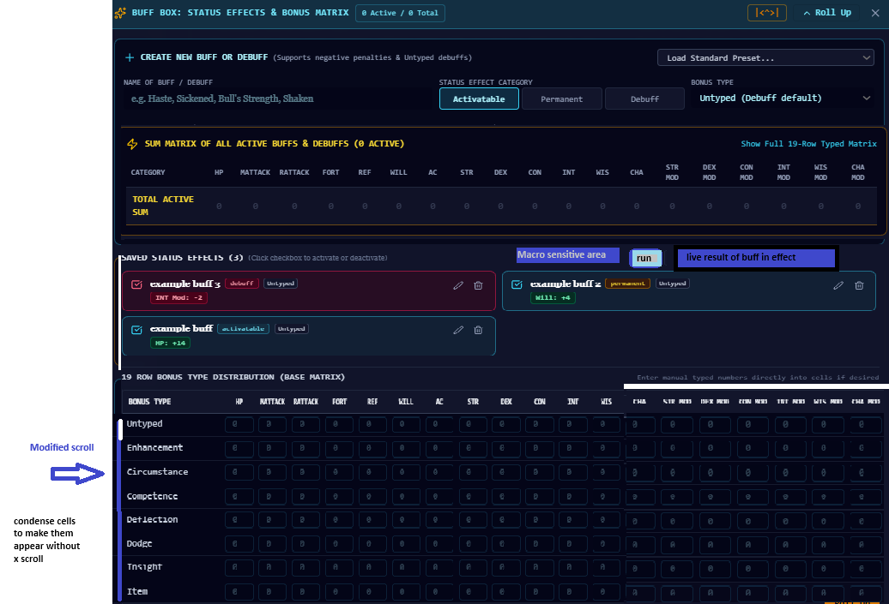

# Macaroni Buff-Making, Simplified Buff Box & Micro Image Cropper Plan

## 1. Macaroni Language Upgrade & `<^...>` Buff-Making Engine
We will expand the Macaroni parser and evaluator (`src/engine/macaroni/`) so it is clearer, more expressive, and directly powers the Buff Box:

### `<^ ... >` Make Buff Construct
- **Syntax**: `Label: | <^ TARGET +VALUE > | $` or unnamed `<^ TARGET +VALUE >`
- **Three Supported Target Formats (Interchangeable)**:
  1. **Matrix Coordinates `{col:row}`**:
     - Example: `MageArmor: | <^{7:2}+4> | $`
     - `col` (1–19) maps to the 19 stat columns (`1=HP, 2=MATTACK, 3=RATTACK, 4=FORT, 5=REF, 6=WILL, 7=AC, 8=STR, 9=DEX, 10=CON, 11=INT, 12=WIS, 13=CHA, 14=STR_MOD, 15=DEX_MOD, 16=CON_MOD, 17=INT_MOD, 18=WIS_MOD, 19=CHA_MOD`).
     - `row` (1–19) maps to the 19 bonus types (`1=Untyped, 2=Enhancement, 3=Circumstance, 4=Competence, 5=Deflection, 6=Dodge, 7=Insight, 8=Item, 9=Inherent, 10=Luck, 11=Morale, 12=Pro/Sac, 13=Race, 14=NAT armor, 15=Armor, 16=Level advance, 17=Shield, 18=Size, 19=Alt size`).
  2. **Readable `Stat.BonusType` Shorthand**:
     - Example: `<^AC.Enhancement+4>`, `<^AC+10>` (defaults to `Untyped`), or multi-stat `<^STR.Morale+4, CON.Morale+4, WILL.Morale+2, AC-2>`.
  3. **Natural All-Caps Phrase**:
     - Example: `<^ENHANCEMENTBONUSTOAC+4>`, `<^UNTYPEDBONUSTOAC+10>`, `<^DODGEBONUSTOAC+2>`.
- **Named vs. Unnamed & `$` Termination Behavior**:
  - **Named (`MageArmor: ...`)**: Creates a saved status effect in `customBuffs`.
    - If terminated with `|$` (e.g., `MageArmor:|<^{7:2}+4>|$`), it acts as a **lock-once sustained buff**—if `MageArmor` is already active, running it again does nothing and outputs a quirky message (*"MageArmor is already woven around you—no double-dipping the arcane cheese!"*).
    - Without `$`, running a named buff macro while it is already active **toggles it off** cleanly.
  - **Unnamed (`<^{7:1}+10>` or `<^AC+10>`)**: Populates the value directly into the base 19-row `buffBox` matrix cells (`Untyped -> AC`).
- **Expanded Macaroni Inputs & Actions**:
  - Add direct calls for `#TOUCH`, `#FF`, `#CMD`, `#CMB`, `#SPEED`, `#CL`, `#SR`, `#DR`, `#THP`, `#MAXHP`, `#NONLETHAL`, and coin purses (`#GP`, `#PP`).
  - Add quirky tabletop flavor commentary when macros crit, fumble, apply buffs, or hit `$` termination.

---

## 2. Simplified Buff Box UI (`src/components/sheet/BuffBoxModule.tsx`)
We will redesign `BuffBoxModule.tsx` to match your reference layout (`/public/assets/aistudio/image_14f1e2fd.png`):

1. **Streamlined Creation Header (`+ CREATE NEW BUFF OR DEBUFF`)**:
   - Remove the intimidating 19-input grid from the top creation panel.
   - Keep the clean single row: `Name of Buff / Debuff`, `Status Effect Category` (`Activatable` | `Permanent` | `Debuff`), `Bonus Type` dropdown, and `Load Standard Preset...` selector (plus a compact quick-add stat pill for manual tweaks when desired).
2. **Sum Matrix of All Active Buffs & Debuffs**:
   - Positioned immediately below the creation bar as a high-contrast summary strip showing all 19 active totals at a glance.
3. **Saved Status Effects Bar with Inline Macro Sensitive Area**:
   - In the `SAVED STATUS EFFECTS` header bar, add:
     - **Macro Sensitive Area**: Input field accepting any `<^...>` or Macaroni buff command (e.g., `MageArmor:|<^{7:2}+4>|$` or `<^AC+10>`).
     - **Run Button**: Executes the buff macro immediately into the Buff Box.
     - **Live Result of Buff in Effect**: Displays the live effect summary and quirky feedback badge right next to the Run button.
   - Saved buffs render below in a clean 2-column card grid with 1-click checkboxes, bonus pills, edit, and delete controls.
4. **Condensed 19-Row Bonus Type Distribution (Base Matrix)**:
   - **Zero Horizontal Scroll**: Condense cell padding, input widths, and column headers so all 19 columns fit within the panel width without horizontal (`x`) scrolling.
   - **Modified Vertical Scroll**: Wrap the 19 rows in a sleek vertically scrollable viewport (`max-h-64 overflow-y-auto`) with subtle `1..19` row/column index badges so `{col:row}` coordinates are effortless to read.

---

## 3. AI Companion Buff Maker (`src/components/tools/AICompanionModal.tsx`)
- Add a dedicated **Buff Maker** tab/section inside the AI Companion tool:
  - Players type any spell, feat, item, or condition in plain English (e.g., *"Sustained +10 untyped bonus to AC"*, *"Barbarian Rage"*, *"Prayer spell"*).
  - The AI generates both the ready-to-use Macaroni `<^...>` syntax and a structured Buff Box object with a 1-click **"Send to Buff Box"** button and **"Test Run"** button.

---

## 4. Standard Buffs Reference in the Macaroni Bible & Quirky Messages
- In `SheetPage4FormulaStudio.tsx` (**Vocabulary Bible** tab), add a **Standard Buffs & Conditions Recipe Guide** with 1-click **Copy** and **Run Now** buttons for:
  - **Sustained +10 Untyped AC**: `IronSkin: | <^AC+10> | $` / `<^{7:1}+10>`
  - **Mage Armor (+4 Enhancement to AC)**: `MageArmor: | <^{7:2}+4> | $`
  - **Bardic Inspiration (Inspire Courage +2)**: `BardicInspiration: <^MATTACK.Competence+2, RATTACK.Competence+2, WILL.Morale+2>`
  - **Barbarian Rage**: `BarbarianRage: <^STR.Morale+4, CON.Morale+4, WILL.Morale+2, AC-2>`
  - **Dodge Feat (Permanent +2 Dodge to AC)**: `DodgeFeat: | <^AC.Dodge+2> | $`
  - **Grappled Condition**: `Grappled: <^DEX-4, MATTACK-2, RATTACK-2>`
  - **Sickened Condition**: `Sickened: <^MATTACK-2, RATTACK-2, FORT-2, REF-2, WILL-2>`
  - **Shaken Condition**: `Shaken: <^MATTACK-2, RATTACK-2, FORT-2, REF-2, WILL-2>`
- Sprinkle witty, Pathfinder-flavored quirky messages across the XDX console, Buff Box live status banner, and DSL tester.

---

## 5. Micro Image Cropper & Staging Editor (`src/components/tools/ImageFileBrowserModal.tsx`)
- Integrate a built-in **Crop & Stage Micro Editor** inside the Image Browser modal whenever a player uploads, selects, or edits character art, portraits, or item icons:
  - **Interactive Pan & Zoom**: Drag the image directly on the staging canvas and adjust zoom (`0.5x` to `3.0x`) and rotation (`90°` steps + horizontal flip).
  - **Aspect Ratio Presets**: `1:1 Square / Token`, `3:4 Portrait`, `4:3 Landscape`, and `Circle Token Mask`.
  - **Tabletop Framing & Borders**: Optional baked-in frames (`None`, `Gilded Gold Ring`, `Dark Iron Bezel`, `Parchment Vignette`).
  - **Save & Apply**: Renders the cropped/staged canvas to a crisp data URL and applies it to the target slot or saves it into the Workspace Image Library.
