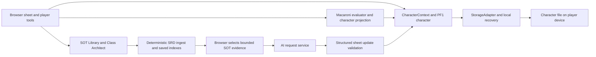
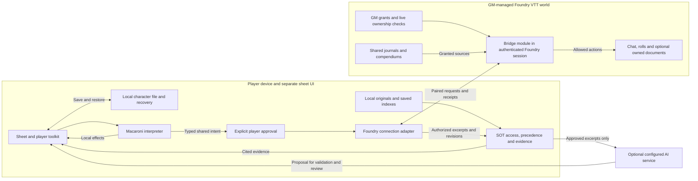

# Foundry VTT project map

The next stage connects the separate browser sheet to Foundry VTT. The player owns the full character, local rules, Macaroni macros, and private notes on their device. The GM owns the shared Foundry world, its documents, and its gameplay permissions. The first pilot reads shared rules without creating or importing a Foundry Actor for the sheet.

## Current project

| Area | Existing entry point | Next change |
| --- | --- | --- |
| Local character and recovery | [`CharacterContext`](../src/context/CharacterContext.tsx), [`StorageAdapter`](../src/storage/types.ts), [`fsAdapter`](../src/storage/fsAdapter.ts) | Keep the local save format and recovery flow. Store optional world pairing metadata separately from character data, backups, and exports. |
| PF1 rules and class tables | [`characterIntegration`](../src/engine/characterIntegration.ts), [`classExtraction`](../src/engine/classExtraction.ts), [`ClassArchitectModal`](../src/components/tools/ClassArchitectModal.tsx) | Apply the existing PF1 calculations and class import logic to validated inputs. Keep Foundry data conversion in a versioned PF1 adapter. |
| Macaroni and player tools | [`macaroni/evaluator`](../src/engine/macaroni/evaluator.ts), [`App`](../src/App.tsx) | Reuse local execution and projection. Offer an explicit send action for supported Foundry operations. |
| Rules and provenance | [`SOTPanel`](../src/components/tools/SOTPanel.tsx), [`server/ingest`](../server/ingest/ingest.ts), [`sotContext`](../server/sotContext.ts) | Add a source provider for shared Foundry content. Resolve access and precedence before selecting excerpts. |
| AI assistant | [`aiService`](../src/engine/aiService.ts), [`sheetFieldWrites`](../src/engine/sheetFieldWrites.ts), [`server/routes`](../server/routes.ts) | Reuse the structured write allowlist and bounded evidence. Add a source preview, separate AI permissions, and confirmation for effects shared to Foundry. |

## Target architecture

| Data | Authority and storage | Crosses the bridge |
| --- | --- | --- |
| Complete sheet, private notes, inventory, portraits, macro source, and local originals | Player device | Only a selected result or a specific field change that the player explicitly approves. |
| Foundry journal pages, compendium content, tokens, and combat state | Foundry world | Permission-checked metadata and bounded excerpts, plus the results of explicitly requested operations. |
| Pairing and action receipts | Expiring session on both sides. The host may keep minimal audit metadata. | An opaque session reference, granted scopes, request ID, status, and revision where needed. |
| AI context | The sheet assembles and previews a bounded selection. The configured AI service receives that selection for the request. | AI context transfer is a separate decision from Foundry pairing. Host content requires both a GM grant for AI use and player approval. |

### Connection and permissions

- **Default mode** starts disconnected with AI off. Players can open and save a sheet, use Macaroni and other player tools, and search local sources while offline. Browser storage fallback and file import/export cover environments where a folder handle is unavailable. [File System Access API](https://developer.chrome.com/docs/capabilities/web-apis/file-system-access)
- **Initial transport** uses a GM-enabled Foundry module and the player's authenticated Foundry tab. A player-initiated launch opens the sheet in a separate tab. Use a short-lived pairing challenge, exact origins and window identity, a declared message schema, and session expiry. Check browser opener policies and pop-up restrictions in the pilot and fail closed when pairing cannot be verified. [Foundry module development](https://foundryvtt.com/article/module-development/) · [Browser messaging](https://developer.mozilla.org/en-US/docs/Web/API/Window/postMessage) · [Browser opener policy](https://developer.mozilla.org/en-US/docs/Web/HTTP/Reference/Headers/Cross-Origin-Opener-Policy)
- **Authorization** binds the session to a world and current Foundry user. The module checks GM policy and live ownership on each read or write. Separate scopes cover source reads, caching/export, AI use, chat, dice, and optional Actor updates. Hide unavailable documents from search results, including titles and metadata. Keep tokens in memory and clear host content and capabilities on disconnect, expiry, world change, or revocation. [Journal page ownership](https://foundryvtt.com/api/v13/classes/foundry.documents.JournalEntryPage.html) · [Compendium ownership](https://foundryvtt.com/api/v13/classes/foundry.documents.collections.CompendiumCollection.html)
- **Private transport** uses the paired window channel for the first release. Foundry's module socket relays arbitrary packets among connected game clients, so exclude player-specific content and credentials from that transport. For a later single-tab experience, evaluate a host-managed HTTPS or WSS relay with expiring, world- and user-scoped access. Confirm the hosting provider permits the deployment and document which supported Foundry client maintains the connection. [Foundry module sockets](https://foundryvtt.com/article/module-development/) · [Foundry public API](https://foundryvtt.com/api/v13/)
- **Shared actions** begin with plain chat and bounded dice requests. A local macro may produce an action for review, and the bridge accepts a closed set of typed operations. Distinguish player-reported rolls from Foundry-native rolls. Native roll creation uses the Foundry client API. A campaign that requires independently verified rolls needs a trusted execution path. [Foundry Roll API](https://foundryvtt.com/api/v13/classes/foundry.dice.Roll.html)
- **Optional Actor links** come after chat and dice. The player and GM may opt in to a link with an existing owned document and allow specific fields. Each update carries a request ID and expected host revision. Recheck the live document and report conflicts before applying a change. A lost receipt calls for refresh and reconciliation before retrying an uncertain operation. [Foundry Actor API](https://foundryvtt.com/api/v13/classes/foundry.documents.Actor.html)

### Source of truth hierarchy

| Profile | Default precedence | Adjustable by |
| --- | --- | --- |
| Personal preparation | Pinned player documents, explicitly selected host sources, then the base rules library | The player can reorder authorized sources and choose a different default by rules category. |
| Live world | GM-pinned campaign rulings and errata, then approved local or host references, then the base rules library | The GM sets the required tier and approved sources. The player orders the remaining eligible sources. |

Resolve access first, apply authority second, and rank relevance within the eligible tier. Keep the source ID or Foundry UUID, world and user scope, origin, revision or content hash, heading or row, and applicable policy alongside each citation. When eligible sources conflict, show both citations and the active precedence rule. When a required live-world rule goes stale or becomes unavailable, show that status before an affected action can be shared. Personal preparation remains usable with local sources.

Use per-world and per-user cache partitions, short expiry, and on-demand refresh. Keep Foundry content read-only through the bridge. A GM can grant an explicit export where the content permits it. Explain that a previously exported local copy remains under the player's control. Use the existing bounded SOT selector for AI and send only relevant, authorized excerpts. AI proposals pass through the existing sheet write validation and the player's review. Shared actions require their own confirmation.

## Compatibility and release phases

Start the pilot with **Foundry VTT 13 and Pathfinder 1 system 11.11**. The official PF1 package lists 11.11 for core versions 12 through 13 and marks 13 verified. The latest stable core release shown on November 25, 2026 was 14.370. Add a version only after it passes the PF1 adapter contract tests and the real-world pairing and permissions checks. During connection, negotiate the bridge protocol, Foundry core generation, and game system ID and version. An unverified pair stays disconnected from shared actions. Use a disposable test world and recorded, sanitized fixtures for Actor and rules shapes. [Pathfinder 1 package](https://foundryvtt.com/packages/pf1) · [Foundry 14.370 release](https://foundryvtt.com/releases/14.370) · [PF1 changelog](https://gitlab.com/foundryvtt_pathfinder1e/foundryvtt-pathfinder1/-/blob/master/CHANGELOG.md)

| Phase | Deliverable | Exit test |
| --- | --- | --- |
| 0. Harden and measure | Use the [performance plan](PERFORMANCE_PLAN.md) to establish the build, load, edit, autosave, and SOT retrieval baselines. Complete the release gates for secret handling, API access, imports, and AI consent before enabling a shared bridge. | Local save and restore survive interruption. The first-render and interaction budgets are measured on representative sheets. Security checks cover player-controlled content and separate AI authorization. |
| 1. Read-only pilot | Versioned bridge protocol, pairing, and one approved Foundry Journal source. Keep the sheet and Foundry separate. | A player reads an allowed rule, cannot discover a restricted rule, and can disconnect or reopen the sheet offline. Verify no character or Actor is created in Foundry. |
| 2. SOT and AI | Combine local rules with authorized host sources. Add source priority controls and citations. Keep AI optional and separately consented. | Conflicts follow the selected profile. Switching worlds or players never reuses a prior world's source cache. Revocation removes access, and a captured AI request includes only explicitly permitted evidence. |
| 3. Chat and dice | Send confirmed chat and dice intents with visible delivery status. Preserve local Macaroni execution. | Approve and post one result from a sheet with no linked Actor. A repeated request does not duplicate the post. Disconnect and uncertain delivery require a visible recovery path. |
| 4. Narrow shared updates | Opt-in mapping to an existing owned PF1 Actor and explicitly enabled fields. Add further core versions or a host relay after dedicated tests. | The adapter refuses unrelated actors, forbidden fields, expired sessions, or stale revisions. Concurrent edits produce a conflict preview. The local sheet works after unlinking. |

Automate protocol schema tests, two-user access isolation, revocation and replay checks, deterministic SOT precedence, offline restore, and mismatched version handling. Run the browser pilot against a GM account and two player accounts with different grants before release. Measure local edits and retrieval separately from bridge and AI latency so offline performance remains visible.
