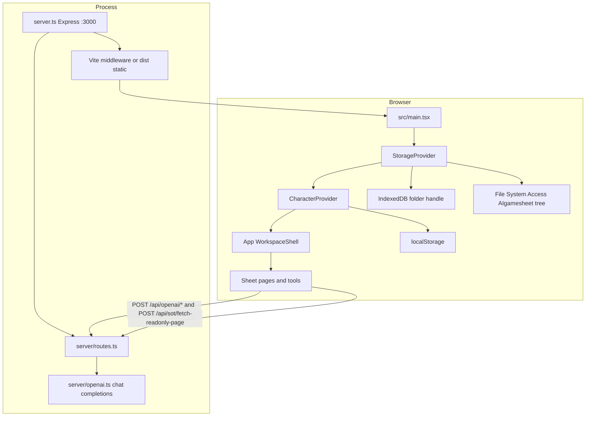
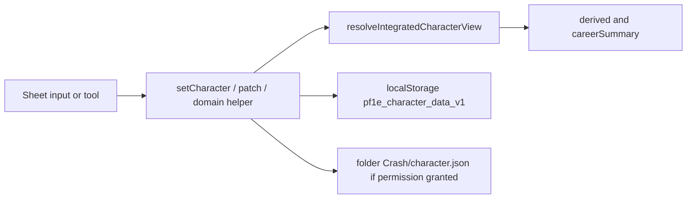
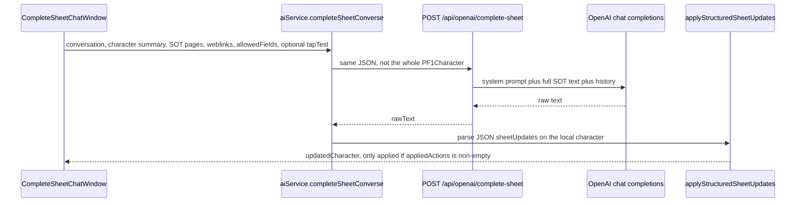

# Program map

How this repository runs on current `main`. Traced from code. `README.md`, `AI_THEORY_AND_ROADMAP.md`, `HOSTING_AND_SHARING.md`, and `docs/copilot-character-engine-handoff/` are not treated as behavior. Where a comment or doc disagrees with code, the part files say so.

This file is the index, the three flow diagrams, and the status table. Detail lives in:

1. [Boot, server, installer, shell](program-map/01-boot-and-shell.md)
2. [Character model and sheet pages](program-map/02-character-and-sheets.md)
3. [Engine](program-map/03-engine.md)
4. [Tools and the AI path](program-map/04-tools-and-ai.md)
5. [Storage, import/export, tests, debris](program-map/05-storage-io-tests-debris.md)

No application code was changed to produce this map.

## Architecture

The mini-browser installer is a separate path. `installer/Start-PF1MW.ps1` serves a prebuilt `index.html` with a loopback `TcpListener` on port 38173 and opens Edge or Chrome with `--app=`. It does not run `server.ts`, so that window has no `/api` routes.

## Edit data flow

Domain helpers that are more than a shallow merge: `applyPointBuyToCharacter`, `applyCareerProgressionToCharacter`, `applyBuffBoxToCharacter`, `applyCustomBuffsWithInventorySync`, `projectMacaroniResult`, `applySelectedImageToCharacter`, and `applyStructuredSheetUpdates` for Complete Sheet. See [part 2](program-map/02-character-and-sheets.md) and [part 3](program-map/03-engine.md).

A deliberate Save writes `pfmusers/{player}/{character}/character.json` and does not update Crash. Crash remains a separate one-slot snapshot. See [part 5](program-map/05-storage-io-tests-debris.md).

## AI request flow

Lookup, macro, buff, journal, and archetype calls use `POST /api/openai/generate` or `POST /api/openai/lookup`. The same handlers are also mounted at `/api/gemini/*`. The key is `OPENAI_API_KEY` on the server. Client `getSessionApiKey` is a no-op. See [part 4](program-map/04-tools-and-ai.md).

## What works, what is shaky, what is missing

| Area | Works | Shaky | Missing |
| --- | --- | --- | --- |
| Dev app | `npm run dev` serves the SPA and API on port 3000. `tsc --noEmit` and `vite build` succeed. | One JS chunk is about 1.1 MB. Production mode expects a prebuilt `dist/`. | No request auth on `/api`. |
| Sheet play | Pages 1, 2 (actions/skills), 3 (bio/storage), and 4 (formula studio) edit one `PF1Character`. Combat numbers on screen come from `computeDerivedCharacterStats`. | Page 3 spells, profile, and notes live in `SheetPage3SpellsBio`, which the shell only mounts as a conditions strip, and nothing toggles that strip. `SheetPage2SkillsGear` is never imported. | A single page that shows spells with the live page 3. |
| Tools | Dice (from sheet roll buttons), point buy, buff box, deck, XDX, macro debug, loadout, Add Class, CMB, journal, new sheet, image browser, AI companion. | Quick HP is rendered but never opened. Sidebar dice and conditions callbacks are unused. Class Architect is tested and not mounted. The AI macro tab cannot be selected. | Class Architect in the shell. |
| AI | Complete Sheet proposes JSON; the client applies it through an allowlist and blind spots. Tap Test constrains that apply path and is tested. | Every saved SOT page's full text goes out on lookup and Complete Sheet. `/api/sot/fetch-readonly-page` fetches whatever `http(s)` URL the client sends. `urlContext` is set on generate and ignored by the OpenAI caller. | Compact retrieval. A host allowlist on the fetch proxy. |
| Save | With a granted folder, `character.json` round-trips. Connect on an empty folder writes the current named sheet and a matching crash copy. | Startup still paints `localStorage` first. A crash whose checksum differs from the named save still wins. SRD "host" copies are `localStorage`, and `SRD/` only gets `README.txt`. | Image bytes and SRD originals in the tree. Re-prompt of a stored handle before any await. |
| Desktop runtime | `Start-PF1MW.ps1` can serve a standalone HTML file in an app window when the files it requires are present. | `Package-PF1MW.ps1` puts `runtime-manifest.json`, a memory-bank template, and AI Studio PNGs in the zip. `Install-PF1MW.ps1` rejects those paths. `Install-PF1MW-Local.ps1` does not copy the files `Start-PF1MW.ps1` requires. | One installer path that matches the packager. |

## Checks run for this map

On Linux, from a clean `npm run lint` (`tsc --noEmit`) and `npm run build` (`vite` 8.3.5): both exited 0. The build warned that `vite.config.ts` uses `__dirname` and that the JS chunk is larger than 500 kB (`dist/assets/index-DZ_KEWeT.js`, about 1,146 kB).

`npm test`: 49 tests, 48 passed, 1 skipped, 0 failed. The skip is `uses a real Windows temp folder...` in `src/storage/fsAdapter.test.ts`, gated on `process.platform === 'win32'`. A different storage test does write a real temp directory on this OS (`connecting a real temporary folder...`).

Coverage is the allowlisted AI sheet writes, Tap Test filtering, three Class Architect parsers, OpenAI client fallback, env-file precedence, and the folder adapter plus Connect. There are no tests for `pf1eMath`, Macaroni evaluation, career math, or React components other than those parsers.
